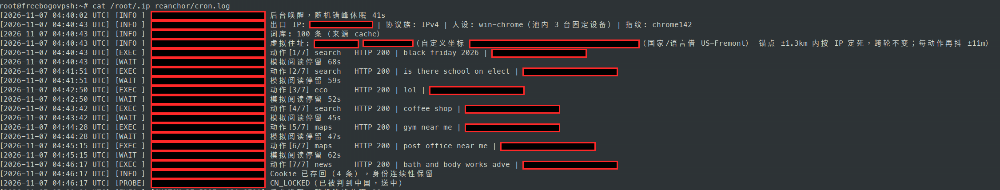
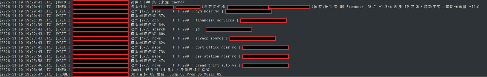

# ip-reanchor — Google「送中」拉回工具

从 [hotyue/IP-Sentinel](https://github.com/hotyue/IP-Sentinel) 的 Google 模块拆出、重写的独立版。
只做一件事：把被 Google 判到中国的 VPS IP，用目标地区的本土流量长期喂回来。

## 缘起

做这个项目，是因为我一个朋友的 VPS 的 IP 被 Google「送中」了。
我参考、研究了一些网上的文章和相关项目之后，才有了这个项目。
我本人其实不需要、也用不到它，但朋友亲测成功了，而且只用了 3 天（见下面「亲测结果」）。

## 原理一句话

IP 的区域画像是被流量喂出来的：之前被大量中文语境流量喂成 CN，
就用目标城市的语言、坐标、当天热搜词再喂回去，直到 Google 的行为判定漂回目标地区。

每轮养护（`run`）做的事，和原版 mod_google 同构：

1. **人设定版**：按出口 IP 哈希固定映射 3 台「家庭设备」，每轮抽一台用。
   UA 与 TLS 指纹同版本绑定（见下），Accept-Language 跟区域语言走。
2. **住址定版**：按出口 IP 哈希在锚点 ±1.3km 内定死一个虚拟住址，跨轮不变（原版每轮在 ±3km 里重掷，等于每 20 分钟搬一次家，不像真住户）；每个动作再抖 ±11m 模拟 GPS 漂移。城市模式和经纬度模式同规。
3. **动作轮盘**：一轮 5–8 个动作，间隔 45–75 秒，按平台加权在
   Google 搜索（当地热搜词）/ Google News / Maps 坐标搜索 / 低风险生态页 / 平台连通性探针之间抽。
   同类动作之间 70% 概率带 Referer，装作站内跳转。
4. **身份连续**：Cookie 按 IP 存盘跨轮复用，不做「每次都是新访客」。
5. **三核自检**：每轮末尾查 google.com 跳转、YouTube Premium、YouTube Music 三路区域判定，
   结果追加进 `probe_history.jsonl`，漂移趋势可查。任一路 CN = 送中报警。

词库每天自动更新：优先拉 Google Trends 当天 RSS（`geo=目标国`），与种子词库合并保留 100 条。

## 与原版的三个差别

| 原版硬伤 | 本版做法 |
|---|---|
| 裸 curl 发请求，TLS 指纹（JA3/JA4）和声称的 Chrome/Firefox UA 对不上 | 用 **curl_cffi impersonate**：TLS + HTTP/2 指纹按目标浏览器生成，UA 严格同版本（Chrome 142 配 chrome142 指纹、Firefox 133 配 firefox133 指纹……） |
| UA 池 1/3 是 Linux Firefox，不像居民区 | 人设池按真实构成配比：桌面 Chrome 为主，Android/iPhone/Firefox/Safari 为辅 |
| Master-Agent + Telegram + OTA 远程执行一整套，攻击面大 | 单机单文件，不要中枢不要远程执行，cron 定时跑，日志和探针历史都在本地 |

没保留原版的「信用净化」（访问本地白名单站点刷 Scamalytics 分）：
那条链路没有证据表明访问新闻站能影响欺诈分数据库，不做假动作。

仍然做不到的事（和原版一样）：伪造不了登录用户与安卓手机的真实 GPS/WiFi 众包定位；
如果这个 IP 还在给大量真实中文用户当代理出口，真人信号会淹掉本工具的信号，效果别指望。

## 亲测结果

朋友的一台美国 Fremont VPS（IPv4）：2026-11-07 探针确诊 **CN_LOCKED**
（google.com 跳转、YouTube Premium、YouTube Music 三路全判 CN），
挂 cron 每 20 分钟一轮开始养护，**约 3 天后（2026-11-10）探针转为 OK，三路全判 US**。

养护前（2026-11-07，探针 CN_LOCKED）：



养护约 3 天后（2026-11-10，探针 OK，三路全判 US）：



截图是日志原文，出口 IP 与全部经纬度已涂抹。这是单个案例，
网段环境不同结果可能不同（见下面注意事项第 3 条）。

## 安装（在要养护的 VPS 上）

依赖用 [uv](https://docs.astral.sh/uv/) 管理（`pyproject.toml` + `uv.lock` 锁版本）：

```bash
git clone https://github.com/alexliyu7352/google_ip.git && cd google_ip
uv sync        # 按 uv.lock 建 .venv 并装好 curl_cffi 这一个依赖
uv run python reanchor.py regions
```

只要 Python 3.10+ 和 curl_cffi 一个依赖（它就是「模拟浏览器的 curl」那套的实现：
原项目是 lexiforest/curl-impersonate，curl_cffi 是它的 Python 封装）。

## 使用

```bash
uv run python reanchor.py regions                    # 67 个城市，找你的区域代码
uv run python reanchor.py probe --region JP-Tokyo    # 先体检：现在被判到哪
uv run python reanchor.py fingerprint                # 自查出口 IP + 三种指纹的 JA3/JA4
uv run python reanchor.py run --region JP-Tokyo --dry-run   # 干跑看一轮会做什么
uv run python reanchor.py run --region JP-Tokyo      # 正式跑一轮（约 6–10 分钟）
```

多 IP 机器用 `--bind 出口IP` 锁出网口，和原版的 `--interface` 一个意思。

双栈机器用 `--ip-version 4` 或 `--ip-version 6`（也可写 `--ipv4` / `--ipv6`）指定要养哪个地址：
探针、全部养护动作、词库抓取、出口 IP 检测都会走同一协议族（底层是 libcurl 的 IPRESOLVE，
等同 `curl -4 / -6`），不会出现 v4 在养、v6 在漏的情况。不给这个参数就跟随系统默认路由。
和 `--bind` 同用时两者要一致，写反了日志会警告。

### 不用城市，直接给经纬度

城市表里没有你要的点，或者你想精确锚到某个街区，用坐标：

```bash
uv run python reanchor.py run --lat 35.6812 --lon 139.7671
uv run python reanchor.py run --lat 47.6062 --lon -122.3321 --gl US --hl en-US
uv run python reanchor.py probe --lat 34.0522 --lon -118.2437
```

`--lat/--lon` 必须成对。`--gl`（目标国家码）和 `--hl`（语言）可以不给：
不给时自动借地理上最近的内置城市的国家与语言（日志里会写明借了哪个城市），词库和探针目标也跟着走。

状态文件默认在 `~/.ip-reanchor/`（`REANCHOR_HOME` 可改）：
`reanchor.log`、`probe_history.jsonl`、`cookies_<ip哈希>.json`、`kw_<国家>.json`。

## 定时跑（关键：这活儿靠的是长期，不是单次）

```cron
*/20 * * * *  cd /path/to/google_ip && $HOME/.local/bin/uv run python reanchor.py run --region JP-Tokyo >/dev/null 2>&1
```

（`uv` 的路径按你机器上的实际安装位置改；用经纬度模式就把 `--region JP-Tokyo` 换成 `--lat … --lon …`；
双栈机器再加 `--ip-version 4` 或 `--ip-version 6` 锁定要养的那个地址。）

和原版一样的节奏：每 20 分钟一轮、一天 72 轮，程序内部还有 0–180 秒随机错峰，
不用再在 cron 里加 sleep。预期以周为单位观察 `probe_history.jsonl` 里
YouTube 两路判定从 CN → 目标国的变化，别看单日。

**拉回后会自动降频（保养模式）**：cron 不用改，还是每 20 分钟唤醒。
探针连续 OK 满 3 天后，脚本自己把治疗频降到保养频：每 6 小时一轮轻动作
（2 个动作 + 探针），每天一轮全量动作压舱，其余唤醒直接跳过、不发请求。
判定不是一次性的，画像会被持续的新流量重新喂——停跑等于只剩污染信号，
可能滑回 CN，所以是降频而不是停。哪天探针再出现非 OK，连续 OK 中断，
自动恢复每轮全量，直到重新连续 OK 满 3 天。手动在终端跑、或显式给
`--actions` 的运行不降频；想彻底关掉降频加 `--no-maintain`。

## 注意事项（部署前先看完）

1. **手机上绝对不要拿这个 IP 当 VPN 或代理出口。**
   安卓的 Google 框架会自己往 Google 发定位数据，这部分流量有可能不走 VPN／代理通道，
   哪怕你开了全局代理也一样。手机的真实位置（比如人就在国内）会顺着这条通道
   源源不断地把这个 IP 往真实所在地喂，本工具喂的信号压不过它，拉不回来。
   除非在服务器端把 Google 框架的定位流量过滤掉，或者把 Google 框架的
   粗定位和精细定位直接关掉，否则别一边拿手机挂这个 IP、一边指望脚本把它拉回来。

2. **确认送中后，第一步先向 Google 提交 IP 更正请求保底，再上脚本。**
   官方表单：https://support.google.com/websearch/workflow/9308722
   （Report IP problems，填被判错的 IP 和它实际所在的国家即可）。
   Google 官方说明处理可能要一个月以上、也不会单独回复你，所以它只能当保底、不能等它：
   提交完就照常在 VPS 上挂 cron 跑本工具，两条线并行，哪条先到都行。

3. **整个网段都被送中的，拉不回来，别白费劲。**
   如果同一个网段里大量 IP 都被判到中国，说明这个网段上正有大量真实中文语境流量
   在持续喂养这个判定。本工具每 20 分钟一轮的信号量，和整个网段其他人的使用量
   完全不在一个量级，信号被淹没、特征立不起来。部署前可以先 probe 同网段的
   其他 IP 探一下，全段都是 CN 的，直接换 IP 或换机房。

## 数据来源与许可

区域坐标/语言锚点与种子词库来自 IP-Sentinel 的 `data/`（AGPL-3.0），只取了 Google 模块需要的字段；
代码为重写实现。热搜词实时取自 Google Trends RSS。
